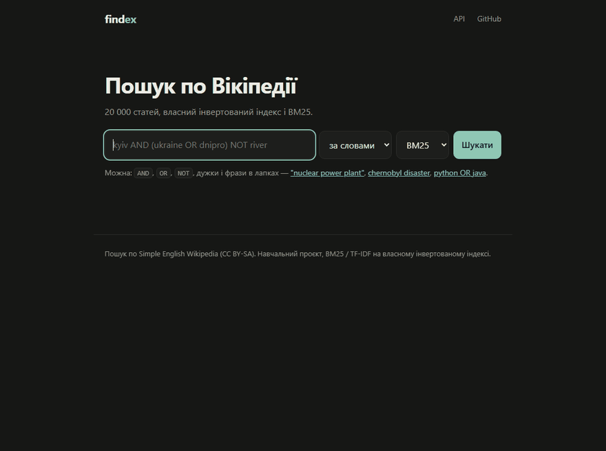
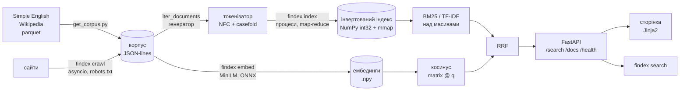

# findex

[](https://github.com/AlexsorBlog/findex/actions/workflows/ci.yml)

**Пошукова система по Simple English Wikipedia, написана з нуля на Python: власний інвертований індекс, BM25, мова запитів, асинхронний краулер, вебсервіс і семантичний пошук.**

**Жива адреса:** _з'явиться тут після деплою на Render (див. «Розгортання»)_ · **Відео (2–3 хв):** _посилання після запису_



| 241 787 статей | p95 = 369 мс | 136× |
|:---:|:---:|:---:|
| увесь корпус, 275 МБ тексту, 910 094 терми | 48 одночасних запитів на один воркер | завантаження індексу: 75.2 с → 0.55 с (pickle → NumPy + mmap) |

Проєкт зростав вісім лаб курсу з Python. Повний журнал із поясненнями
кожного рішення — у [docs/LABS.md](docs/LABS.md).

---

## Спробувати за хвилину

```bash
uv sync
uv run findex index demo/simplewiki-4000.jsonl --out data/demo.pkl --positions
uv run findex search data/demo.pkl 'kyiv AND (ukraine OR dnipro) NOT river'
uv run findex serve --index data/demo.pkl          # http://127.0.0.1:8000
```

Або в Docker, де індекс і ембединги збираються всередині образу:

```bash
docker build -t findex . && docker run -p 8000:8000 findex
```

Мова запитів: `AND` (і просто пробіл), `OR`, `NOT`, дужки, `"фрази в лапках"`.
Режими: `lexical` (BM25 / TF-IDF), `semantic` (ембединги), `hybrid` (злиття через RRF).

## Як ідуть дані



| Шар | Модуль | Лаба |
|---|---|---|
| потокове читання корпусу | `corpus.py`, `tokenize.py` | 1 |
| інвертований індекс, збереження | `index.py`, `store.py` | 2 |
| рейтинг, мова запитів, сніпети | `scoring.py`, `query.py`, `snippet.py` | 3 |
| CLI, типи, тести, пакування | `cli.py`, `pyproject.toml` | 4 |
| паралельна індексація | `parallel.py` | 5 |
| асинхронний краулер | `crawler/` | 6 |
| вебсервіс | `web/`, `Dockerfile` | 7 |
| NumPy-індекс, семантика | `numpy_index.py`, `semantic.py`, `hybrid.py` | 8 |

---

## Усі виміри в одному місці

Машина: Intel Core i7-12650H (10 ядер / 16 потоків), 16 ГБ, Windows 11, Python 3.13.
Як отримано кожне число — у [docs/LABS.md](docs/LABS.md).

### Лаба 1. Генератори проти списків

| Версія | Документів | Пік пам'яті | Час |
|---|---|---|---|
| eager (списки) | 50 000 | 886.9 МБ | 76.1 с |
| lazy (генератори) | 50 000 | 23.8 МБ | 75.3 с |
| lazy (генератори) | 241 787 (усі) | 79.2 МБ | 283.2 с |

### Лаба 2. Як зберігати постинги (20 000 документів)

| Представлення | Пам'ять при побудові | Файл | Завантаження |
|---|---|---|---|
| `list[Posting]`, звичайний dataclass | 408.9 МБ | 80.4 МБ | 15.9 с |
| `list[Posting]`, `slots=True` | 269.7 МБ | 59.6 МБ | 48.7 с |
| пари `array('I')` | 100.6 МБ | 38.3 МБ | 2.2 с |

### Лаба 3. Якість рейтингу, precision@5 (10 запитів)

| TF-IDF | BM25 |
|---|---|
| 0.76 | 0.74 |

### Лаба 5. Паралельна індексація

| Конфігурація | Wall | Прискорення |
|---|---|---|
| serial, 20 000 док. | 10.89 с | 1.00× |
| threads × 8 (GIL) | 10.83 с | 1.01× |
| processes × 16, `slots` | 17.34 с | 0.63× |
| processes × 16, `array` | 3.17 с | 2.24× |
| threads × 8 на Python 3.13t без GIL | 4.45 с | 2.25× |
| **увесь корпус**, processes × 16 | 22.6 с проти 68.1 с | **3.01×** |

Спільний `Counter` без замка на збірці без GIL загубив **316 860 із 400 000** оновлень.


### Лаба 6. Краулер (200 сторінок, один хост)

| Конкурентність | Wall | Сторінок/с |
|---|---|---|
| 1 | 29.1 с | 6.87 |
| 5 | 13.7 с | 14.58 |
| 20 | 13.2 с | 15.10 |
| 20 без лімітів на хост (не лишав) | 3.7 с | 54.56 |

### Лаба 7. Вебсервіс під навантаженням (48 одночасних запитів)

| Конфігурація | Запитів/с | p50 | p95 | p99 |
|---|---|---|---|---|
| 1 воркер, `async def` | 150.3 | 316 мс | 369 мс | 412 мс |
| 1 воркер, `def` | 150.6 | 326 мс | 372 мс | 412 мс |
| 4 процеси, `def` | 325.8 | 31 мс | 543 мс | 585 мс |
| розгорнутий сервіс | _після деплою_ | | | |

### Лаба 8. NumPy і семантика (увесь корпус)

| Що | Лаба 3 | Лаба 8 | Прискорення |
|---|---|---|---|
| скорер, частий терм `the` | 437.2 мс | 24.7 мс | 18× |
| скорер, рідкісний терм `kyiv` | 0.5 мс | 0.6 мс | 1× |
| скорер, три терми | 28.1 мс | 3.6 мс | 8× |
| завантаження індексу | 75.2 с | 0.55 с | **136×** |

| precision@5 | BM25 | Семантика | Гібрид |
|---|---|---|---|
| 10 запитів з лаби 3 | 0.74 | 0.52 | **0.78** |
| 5 перефразів без ключових слів | 0.00 | 0.32 | 0.32 |

---

## Обмеження

Прямо, без прикрас:

- **Корпус англійський.** Токенізатор вміє кирилицю, але модель ембедингів
  і статті — англійські. Українською семантичний пошук майже нічого не знайде.
- **Без стемінгу.** `disaster` і `disasters` — різні терми.
- **Семантика бачить лише перші ~160 слів статті** (2 фрагменти по 80 слів):
  ембединги 20 000 документів і так рахувались 21 хвилину на CPU.
- **Розгорнутий сервіс — на 4 000 статтях** і на NumPy-індексі без позицій,
  щоб влізти в 512 МБ безкоштовного плану. Тому фрази в лапках там повертають
  422 з поясненням. Локально з `--positions` вони працюють.
- **Індекс будується наново, а не доповнюється.** Додати один документ —
  це повна переіндексація.
- **precision@5 — на 15 запитах, розмічених мною.** Одна стаття різниці дає 0.2.
  Це показник тенденції, а не бенчмарк.
- **Навантаження міряне моїм навантажувачем на httpx, а не oha;** на Windows
  `uvicorn --workers` наполовину падає, тож «4 процеси» локально — це 4 окремі
  uvicorn на різних портах.
- **Docker на моєму ноутбуці не встановлений:** образ збирає й перевіряє CI.

## Розгортання

`render.yaml` описує сервіс для Render: Docker-образ, `/health` як перевірка
платформи, конфіг лише зі змінних оточення (`INDEX_PATH`, `EMBEDDINGS_PATH`,
`WEB_CONCURRENCY`, `MAX_K`). На Render: **New → Blueprint →** цей репозиторій.

## Розробка

```bash
uv sync --group dev
uv run pytest                       # усі тести
uv run pytest --cov=findex          # з покриттям
uv run pyright                      # strict, 0 помилок
uv run ruff check . && uv run ruff format --check .
```

Корпус (`data/`) у git не лежить. Як його завантажити — у [docs/LABS.md](docs/LABS.md#корпус).
Демо-зріз із 4 000 статей лежить у `demo/`. Тексти — Simple English Wikipedia, CC BY-SA.
