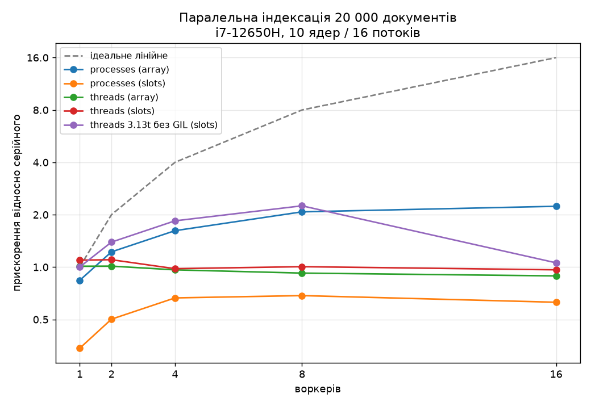

# findex

[](https://github.com/AlexsorBlog/findex/actions/workflows/ci.yml)

Мій проєкт пошукової системи для курсу з Python. Кожна лаба додає нову частину.
Зараз програма вміє читати корпус потоком і рахувати статистику, не завантажуючи
весь корпус у пам'ять (Лаба 1), а також будувати інвертований індекс, зберігати
його на диск і відповідати на Boolean-запити (Лаба 2).

# Лаба 1. Потік замість списків

## Корпус

Я взяв **Simple English Wikipedia** (дамп від 01.11.2023).
Це 241 787 статей, приблизно 275 МБ тексту у форматі JSON-lines.

Корпусу немає в git, бо `data/` додана в `.gitignore`. Як його завантажити:

```bash
mkdir data
curl -L -o data/simplewiki.parquet https://huggingface.co/datasets/wikimedia/wikipedia/resolve/main/20231101.simple/train-00000-of-00001.parquet
uv run --group corpus python scripts/get_corpus.py data/simplewiki.parquet data/simplewiki.jsonl
```

Скрипт читає parquet частинами і записує одну статтю в рядок:
`{"id": ..., "title": ..., "text": ...}`.

## Запуск

```bash
uv sync
uv run pytest
uv run ruff check .
uv run pyright

# встановити як команду (лаба 4)
uv tool install .
findex index data/simplewiki.jsonl --out data/index.pkl --limit 20000 --positions
findex search data/index.pkl 'kyiv AND (ukraine OR dnipro) NOT river' --k 5
findex stats data/index.pkl

# те саме без встановлення
uv run findex --help

# паралельна збірка (лаба 5): корпус спершу ділиться на шарди
uv run python scripts/shard_corpus.py data/simplewiki.jsonl data/shards 32
findex index data/shards --out data/index.pkl --executor processes --workers 8 --repr array
uv run --group bench python scripts/bench_parallel.py data/shards --repeats 3
uv run --group bench python scripts/bench_full_corpus.py data/shards_full
uv run --group bench python scripts/plot_speedup.py
uv run python scripts/race_demo.py

uv run python -m findex.stats data/simplewiki.jsonl              # весь корпус
uv run python -m findex.stats data/simplewiki.jsonl --limit 1000 # перші 1000 документів
uv run python -m findex.stats data/simplewiki.jsonl --eager      # версія через списки

uv run python -m findex.index data/simplewiki.jsonl --out data/index.pkl --limit 20000
uv run python -m findex.search data/index.pkl "kyiv OR lviv NOT river"
uv run python -m findex.search data/index.pkl "kyiv ukraine" --engine set
uv run python scripts/bench_search.py data/index.pkl

uv run python -m findex.index data/simplewiki.jsonl --limit 20000 --positions --out data/index.pkl
uv run python -m findex.search data/index.pkl 'kyiv AND (ukraine OR dnipro) NOT river' --k 5
uv run python -m findex.search data/index.pkl '"nuclear power plant"' --scorer tfidf
uv run python -m findex.search data/index.pkl 'chernobyl' --verbose --repeat
uv run python scripts/sanity_ranking.py data/index.pkl
uv run python scripts/eval_queries.py data/index.pkl
```

Команди `python -m findex.index` і `python -m findex.search` із лаб 2–3 у лабі 4
замінені на `findex index` і `findex search` (див. розділ лаби 4).

## Структура

```txt
src/findex/
  corpus.py     iter_documents(root) -> Iterator[Document]
  tokenize.py   tokenize(text) -> Iterator[str]
  stats.py      конвеєр + CLI (python -m findex.stats)
  index.py      побудова інвертованого індексу + CLI
  search.py     Boolean-пошук (merge і set) + CLI
  store.py      збереження/завантаження індексу (pickle і json) + open_index
  merge.py      двовказівникові merge-операції
  query.py      парсер запитів і дерево вузлів
  scoring.py    протокол Scorer, TfIdf, BM25, топ-k
  snippet.py    сніпети з підсвіткою
  decorators.py @timed
  cli.py        CLI на typer (команда findex)
  __main__.py   python -m findex
  parallel.py   build_partial / merge і три екзекутори
scripts/
  get_corpus.py parquet -> jsonl
  bench_search.py  порівняння merge і set
  sanity_ranking.py три перевірки рейтингу
  eval_queries.py  precision@5 для TF-IDF і BM25
  shard_corpus.py  поділити корпус на шарди
  bench_parallel.py бенчмарк serial/threads/processes
  bench_full_corpus.py те саме на всьому корпусі
  bench_freethreaded.py потоки на 3.13t
  bench_io.py      контрольний дослід на вводі-виводі
  plot_speedup.py  графік прискорення
  race_demo.py     гонитва, яку ховає GIL
tests/
  conftest.py       спільні фікстури
  test_tokenize.py
  test_index.py
  test_ranking.py
  test_cli.py       CLI через CliRunner
  test_properties.py властивості Hypothesis
  test_parallel.py  паралельна збірка
.github/workflows/
  ci.yml
```

- `iter_documents` працює з файлом `.jsonl`, файлом `.txt` або папкою з ними.
  Це генератор, тому `next(iter_documents(Path("data")))` повертає результат одразу.
  Якщо в рядку битий UTF-8 або неправильний JSON, я пишу попередження в лог і пропускаю цей рядок.
- `tokenize` теж генератор і використовує `re.finditer`, а не `re.findall`.
- `stats.py` рахує все за один прохід. `--limit` зроблено через `itertools.islice`.

## Правила токенізатора

1. Спочатку NFC-нормалізація, потім `casefold()`. Через NFC `"café"` і
   `"café"` стають однаковим токеном. Через casefold `"Straße"` збігається з `"STRASSE"`.
2. Токен складається з букв і цифр (`\w` без `_`), тому кирилиця теж працює.
3. **Апострофи:** `’` і `ʼ` замінюються на звичайний `'`. Апостроф усередині слова
   залишається: `don't`, `п'ять`. На початку або в кінці слова він прибирається.
4. **Дефіси:** дефіс між частинами слова залишається: `e-mail`, `state-of-the-art`.
   Окремий дефіс або дефіс у кінці слова прибирається.
5. **Цифри:** числа вважаються токенами, як і слова (`1999`). `3.14` дає `3` і `14`,
   бо крапка розділяє токени.
6. Підкреслення та інша пунктуація розділяють токени.

Тести на це все лежать у `tests/test_tokenize.py`. Там же є тест, що биті рядки в корпусі пропускаються.

## Результат на всьому корпусі

```
режим:          lazy (генератори)
документів:     241,787
токенів:        43,089,357
словник:        910,094
час:            283.23 с
пікова пам'ять: 79.2 МБ
```

Топ-50 термів:

| # | терм | к-сть | # | терм | к-сть |
|---|---|---|---|---|---|
| 1 | the | 2,321,936 | 26 | 1 | 155,693 |
| 2 | of | 1,224,678 | 27 | 2 | 149,135 |
| 3 | in | 1,139,658 | 28 | an | 143,244 |
| 4 | and | 900,710 | 29 | american | 143,128 |
| 5 | a | 780,549 | 30 | 0 | 138,904 |
| 6 | is | 602,198 | 31 | people | 136,356 |
| 7 | to | 552,122 | 32 | his | 132,999 |
| 8 | was | 455,967 | 33 | other | 125,681 |
| 9 | it | 278,791 | 34 | or | 110,776 |
| 10 | from | 269,580 | 35 | they | 108,697 |
| 11 | he | 268,751 | 36 | 3 | 106,304 |
| 12 | on | 264,410 | 37 | this | 100,589 |
| 13 | for | 262,649 | 38 | also | 100,387 |
| 14 | as | 245,791 | 39 | linear | 97,183 |
| 15 | by | 221,943 | 40 | socorro | 96,527 |
| 16 | right | 193,988 | 41 | 4 | 91,049 |
| 17 | km | 187,527 | 42 | has | 90,588 |
| 18 | align | 186,935 | 43 | were | 87,942 |
| 19 | bgcolor | 186,149 | 44 | be | 87,358 |
| 20 | id | 184,623 | 45 | she | 86,480 |
| 21 | with | 176,820 | 46 | united | 85,768 |
| 22 | that | 171,844 | 47 | new | 82,075 |
| 23 | at | 163,122 | 48 | first | 81,711 |
| 24 | are | 161,658 | 49 | born | 79,520 |
| 25 | references | 156,754 | 50 | 5 | 79,355 |

Цікаво, що в топ потрапили `align`, `bgcolor`, `linear` і `socorro`. Перші два
залишилися від розмітки таблиць у дампі, а останні два з'являються в тисячах статей
про астероїди ("discovered by LINEAR at Socorro"). Мабуть, пізніше це треба буде почистити.

## Eager проти lazy

Версія eager (`--eager`) спочатку читає всі документи в список, потім робить
список токенів для кожного документа, потім один великий плаский список, і тільки
після цього рахує. Обидві версії я запускав на тих самих даних на своєму ноутбуці
(Python 3.13, Windows 11), в обох був увімкнений `tracemalloc`:

| Версія | Документів | Токенів | Пікова пам'ять | Час |
|---|---|---|---|---|
| eager (списки) | 10 000 | 4 994 913 | 350.9 МБ | 29.68 с |
| lazy (генератори) | 10 000 | 4 994 913 | 12.0 МБ | 30.20 с |
| eager (списки) | 50 000 | 12 725 076 | 886.9 МБ | 76.11 с |
| lazy (генератори) | 50 000 | 12 725 076 | 23.8 МБ | 75.30 с |
| lazy (генератори) | 241 787 (усі) | 43 089 357 | 79.2 МБ | 283.23 с |

На всьому корпусі eager я не запускав, бо за цими числами йому треба кілька ГБ пам'яті.

**Чому така різниця.** В eager-версії пам'ять одночасно йде в три місця.
Список документів тримає весь текст. Список списків токенів тримає кожен токен
як окремий об'єкт `str` (приблизно 50+ байт кожен, плюс 8-байтовий вказівник у списку).
Плаский список додає ще по одному вказівнику на кожен токен. На 5 мільйонах токенів
це вже сотні МБ, і ця цифра росте разом із розміром корпусу. У lazy-версії в пам'яті
одночасно тільки один документ і поточний токен. Реально росте тільки `Counter`, бо він
зберігає кожне унікальне слово один раз разом із кількістю. Тому пам'ять lazy-версії
залежить від **розміру словника** (164 тис. -> 313 тис. -> 910 тис. слів), а не від
кількості токенів. Нулем вона не буде, бо `Counter` і є відповіддю, і він мусить десь
зберігатися. Час майже однаковий, бо обидві версії роблять ту саму роботу
(нормалізація, regex, підрахунок). До того ж сам `tracemalloc` помітно сповільнює обидва запуски.


# Лаба 2. Інвертований індекс

## Що з'явилося

- `index.py` будує індекс за один прохід по лінивому пайплайну з лаби 1:
  - `postings` — терм -> список постингів, відсортований за `doc_id`;
  - `doc_lengths` — кількість токенів у документі (знадобиться для BM25 у лабі 3);
  - `doc_meta` — `doc_id` -> шлях і заголовок, щоб було що показати в результатах.
- `Posting` і `DocMeta` — це `@dataclass(frozen=True, slots=True)`, тому вони незмінні
  й хешовані (їх можна класти в `set`). Постинги збираються через `defaultdict(list)`.
  Сортувати нічого не треба: `doc_id` росте разом із потоком, тому списки виходять
  відсортованими самі собою.
- `--positions` додатково зберігає позиції токенів (потрібні для пошуку фраз у лабі 3).
- `search.py` розуміє запити виду `term term` (це AND), а також `OR` і `NOT`.
  Операції зроблені двовказівниковим merge по відсортованих списках, а `--engine set`
  перемикає на варіант через множини.
- `store.py` зберігає й завантажує індекс у двох форматах: `pickle` (за розширенням
  `.pkl`) і `json` (за розширенням `.json`).

У лабі 3 словники з цієї лаби перетворилися на клас `Index`, але все описане нижче
працює так само, просто через об'єкт.

**Про pickle.** `pickle.load()` виконує код, записаний у файлі, тому відкривати
чужий або завантажений з інтернету `.pkl` небезпечно: це готова діра для виконання
довільного коду. Я завантажую тільки свої власні файли індексу. Якби індекс треба
було комусь передавати, я б брав `json`.

## Три способи зберігати постинги

Усі три на тих самих 20 000 документах (221 223 терми), під `tracemalloc`:

| Постинги | Пікова пам'ять (побудова) | Розмір pickle | Завантаження pickle | Пікова пам'ять (завантаження) |
|---|---|---|---|---|
| `list[Posting]`, звичайний dataclass | 408.9 МБ | 80.4 МБ | 15.90 с | 1442.5 МБ |
| `list[Posting]`, `slots=True` | 269.7 МБ | 59.6 МБ | 48.66 с | 857.6 МБ |
| пари `array('I')` (doc_id, tf) | 100.6 МБ | 38.3 МБ | 2.20 с | 193.7 МБ |

**Куди пішли байти.** У першому рядку кожен постинг — це окремий об'єкт Python,
і в нього є свій `__dict__` зі словником атрибутів. Сам словник — це ще близько
100+ байт на екземпляр, хоча корисних даних там всього два числа. У другому рядку
`slots=True` прибирає цей `__dict__` і залишає тільки фіксовані слоти, тому
екземпляр стає приблизно в півтора раза меншим — це і видно в таблиці (409 -> 270 МБ).
Але об'єкти все одно залишаються об'єктами: у списку лежать 8-байтові вказівники,
а кожне число `int` у Python — це теж окремий об'єкт на 28 байт. Третій рядок
прибирає об'єкти взагалі: `array('I')` тримає числа як сирі 4-байтові значення
підряд, без вказівників і без заголовків об'єктів. Тому він у 4 рази менший за
перший варіант і завантажується в 7 разів швидше.

Несподіванка: `slots=True` зберігається і завантажується **повільніше** за звичайний
dataclass (48.66 с проти 15.90 с), хоча пам'яті їсть менше. Як я зрозумів, це тому,
що об'єкт без `__dict__` pickle серіалізує через `__reduce_ex__` і стан у вигляді
кортежу, а не одним словником. Тобто виграш у пам'яті тут коштує часу.

## Ціна позицій

Той самий зріз корпусу, `slots`, з прапорцем `--positions`:

| Варіант | Пікова пам'ять | Розмір файлу | Час побудови |
|---|---|---|---|
| без позицій | 269.7 МБ | 59.6 МБ | 67.99 с |
| з позиціями | 587.7 МБ | 82.7 МБ | 87.38 с |

Пам'ять виросла більш ніж удвічі, бо на кожен постинг додається кортеж із позиціями,
а це ще один об'єкт плюс по 8 байт на вказівник і по 28 байт на кожне число.

## Два формати збереження

| Формат | Розмір | Save | Load |
|---|---|---|---|
| pickle, `slots` | 59.6 МБ | 25.96 с | 48.66 с |
| json, `slots` | 57.7 МБ | 18.37 с | 11.94 с |
| pickle, `array` | 38.3 МБ | 1.25 с | 2.20 с |
| json, `array` | 37.7 МБ | 4.14 с | 2.34 с |

json виявився не більшим за pickle (числа в тексті займають мало, а pickle пише
ще й заголовки об'єктів) і при цьому безпечний. Мінус json у тому, що він не знає
типів: ключі-числа стають рядками, кортежі стають списками, тому при завантаженні
я збираю `Posting` і `array` назад вручну.

## merge проти set

Бенчмарк на індексі з 20 000 документів (`scripts/bench_search.py`), два найчастіші
терми, два найрідкісніші та змішаний випадок:

| Запит | Довжини списків | merge, мс | set, мс |
|---|---|---|---|
| `of the` | 18746 + 19298 | 4.505 | 3.943 |
| `aperire ridran` | 1 + 1 | 0.007 | 0.008 |
| `of aperire` | 18746 + 1 | 0.493 | 1.647 |

Обидва варіанти — O(n + m), але константи різні. Коли обидва списки великі,
`set` трохи виграє, бо перетин множин зроблений на C, а мій merge — це цикл на Python.
Коли ж один список великий, а другий крихітний, merge виграє в 3 рази: він просто
йде вказівниками і майже одразу впирається в кінець короткого списку, а `set`
зобов'язаний спочатку побудувати множину з усіх 18 746 елементів великого списку.
У реальному пошуку другий випадок трапляється набагато частіше, бо рідкісні слова —
це і є цікаві запити. Плюс merge працює з відсортованими списками потоком, тому
пізніше його можна буде запустити і на стиснених постингах прямо з диска.

## Демо

```
$ uv run python -m findex.search data/index.pkl "kyiv OR lviv NOT river" --top 5
запит:          kyiv OR lviv NOT river  (engine=merge)
знайдено:       21 документів
час пошуку:     2.91 мс
```

## Тести

`tests/test_index.py` — 24 тести разом із лабою 1: сортування постингів і частоти
термів, незмінність і хешованість `Posting`/`DocMeta`, три merge-операції, розбір
запиту, збіг результатів merge і set, позиції, варіант з `array` та збереження
і завантаження в обох форматах для всіх трьох представлень.


# Лаба 3. Рейтинг і модель об'єктів

## Index як справжній об'єкт Python

`Index` тепер успадковує `collections.abc.Mapping`, тому поводиться як словник термів:

```python
>>> with open_index("data/index.pkl") as ix:
...     ix
...     len(ix)            # кількість термів
...     "kyiv" in ix       # __contains__
...     ix["kyiv"][:2]     # __getitem__, KeyError якщо терма немає
...     ix.num_docs, round(ix.avg_doc_length, 1), ix.df("kyiv")
Index(terms=221_223, docs=20_000, repr='slots', positions=True)
221223
True
[Posting(doc_id=576, tf=1, positions=(683,)), ...]
(20000, 394.5, 23)
```

Від `Mapping` безкоштовно приходять `keys()`, `items()`, `get()` і `__contains__` —
мені достатньо було написати `__getitem__`, `__len__` та `__iter__`.
`num_docs` — це `@property`, а `avg_doc_length` — `@cached_property`: BM25 просить
середню довжину документа для **кожного** документа, тому вважати її щоразу означало б
проходити по 20 000 значень на кожен бал.

Одна пастка, на яку я натрапив: `Mapping` явно ставить `__hash__ = None`, а мені
індекс потрібен як ключ для `lru_cache`. Тому в класі є рядок
`__hash__ = object.__hash__` — хеш за ідентичністю, один об'єкт індексу = один ключ кеша.

`open_index(path)` — context manager на `@contextmanager`: усе до `yield` це `__enter__`,
усе після — `__exit__`. Пам'ять звільняється і тоді, коли в тілі `with` стався виняток
(на це є тест `test_open_index_releases_on_error`).

## Scorer: TF-IDF і BM25

`Scorer` — це `typing.Protocol` з одним методом `score(term, posting, index)`.
`TfIdf` і `BM25(k1=1.5, b=0.75)` нічого не успадковують, вони просто мають потрібний
метод (у них ще й `__call__ = score`, тому їх можна викликати як функції). Бали
накопичуються у словнику, а топ-k беруться через `heapq.nlargest` — це O(n log k)
замість повного сортування O(n log n).

Результат — `@dataclass(order=True, frozen=True, slots=True)` `SearchResult`. Поле
`score` я поставив **першим** саме для того, щоб `sorted(results)` сортував за балом.

### Три перевірки на моєму корпусі

`uv run python scripts/sanity_ranking.py data/index.pkl`:

**1. Рідкісний терм важить більше за частий.** `df(kyiv)=23`, `df(the)=19298`.
На запит `kyiv OR the` зверху документи з рідкісним термом:

```
 15.211  Kyiv
 11.341  Ukraine
 10.685  Pripyat
```

**2. Насичення tf.** Той самий документ (726 токенів), терм `kyiv`, різні tf:

| tf | 1 | 2 | 3 | 5 | 20 | 100 |
|---|---|---|---|---|---|---|
| бал BM25 | 4.895 | 7.588 | 9.292 | 11.327 | 15.029 | 16.464 |

Від 1 до 2 входжень бал зростає на 2.7, а від 20 до 100 — лише на 1.4. Це робить `k1`:
бал прагне до межі `idf * (k1 + 1)`, тому 20-те повторення вже майже нічого не додає.

**3. Довжина документа.** Обидва документи містять `kyiv` рівно один раз:

| Документ | Токенів | Бал BM25 |
|---|---|---|
| Antonov An-225 Mriya | 190 | 8.799 |
| Chicago | 3607 | 1.446 |

Різниця в 6 разів — це робота `b`: коротка стаття з одним входженням справді про Київ,
а в довгій це випадкова згадка. При `b = 0` нормалізація зникає і ці два бали стали б однаковими.

## Мова запитів

`query.py` — рекурсивний спуск за такою граматикою:

```txt
or_expr  -> and_expr ('OR' and_expr)*
and_expr -> not_expr ('AND'? not_expr)*
not_expr -> 'NOT' atom | atom
atom     -> term | "phrase" | '(' or_expr ')'
```

Вузли `Term`, `Phrase`, `And`, `Or`, `Not` — це frozen-датакласи з перевантаженими
`&`, `|`, `~`, тому дерево можна будувати і руками, без рядка:
`Term("a") & (Term("b") | Term("c"))`. У кожного вузла є `evaluate(index)`, який
працює на відсортованих списках через merge-операції з лаби 2.

Тести парсера порівнюють **дерева**, а не рядки, і це саме те, що дає `__eq__` від датакласів:

```python
parse("a OR b c") == Or(Term("a"), And(Term("b"), Term("c")))
```

`a OR b c` розбирається як `Or(a, And(b, c))`, бо `OR` стоїть вище в граматиці:
`or_expr` викликає `and_expr`, тому неявний AND зв'язує сильніше.

Фрази (`"nuclear power plant"`) працюють на позиціях з лаби 2: слово вважається продовженням
фрази, якщо серед його позицій є `p + 1`. Я звів це до перетину множин зі зсувом,
тому індекс треба будувати з `--positions`.

Приклад фразового запиту (порядок слів важливий, `"plant power nuclear"` не знайде нічого):

```
$ uv run python -m findex.search data/index.pkl '"nuclear power plant"' --k 2 --no-snippets
 20.112  Nuclear
 18.471  Nuclear power
```

## @timed, кеш і сніпети

`@timed` зроблений на замиканні з `functools.wraps` (без `wraps` у `search.__name__`
опинилося б `wrapper`) і пише в лог `findex.timing`. На шляху «запит -> id документів»
стоїть `@lru_cache(maxsize=256)`. Запуск з `--verbose --repeat` показує попадання в кеш:

```
findex.timing | load -> 12286.91 мс
findex.search | кеш запитів: CacheInfo(hits=0, misses=1, maxsize=256, currsize=1)
findex.timing | matching_docs -> 8.36 мс
findex.timing | ranked_search -> 17.05 мс
findex.search | кеш запитів: CacheInfo(hits=1, misses=1, maxsize=256, currsize=1)
findex.timing | matching_docs -> 0.07 мс
findex.timing | ranked_search -> 3.35 мс
```

Другий раз той самий запит знайшов документи за 0.07 мс замість 8.36 мс, тобто
приблизно в 120 разів швидше. `@timed` я поставив **зовні** кеша саме для того,
щоб попадання теж було видно в логу.

Сніпети — вікно ±80 символів навколо найкращого входження, терми в дужках `[...]`:

```
$ uv run python -m findex.search data/index.pkl 'kyiv AND (ukraine OR dnipro) NOT river' --k 3
 17.471  Pripyat
          ...pyat Pripyat (Ukrainian: При́п'ять) is an abandoned city in northern [Ukraine]. It lies in [Kyiv] Oblast, near the border with Belarus...
 17.171  Antonov An-225 Mriya
          ...ownership of Antonov was switched to the country of [Ukraine], and all assets were shipped to [Kyiv], or Kiev...
 16.580  Chernobyl
          Chernobyl Chernobyl or Chornobyl () is a city in northern [Ukraine], near the border with Belarus...
```

Щоб дістати текст документа для сніпета, я додав у `DocMeta` поле `offset` — зміщення
рядка в jsonl-файлі. Сніпет просто робить `seek(offset)` і читає один рядок,
а не перечитує весь корпус.

## precision@5: TF-IDF проти BM25

10 запитів, для кожного я вручну склав список статей, які **мають** бути в топ-5
(`scripts/eval_queries.py`, словник `LABELS`). P@5 — це скільки з 5 виданих документів
є в моєму списку, поділене на 5.

| Запит | TF-IDF | BM25 |
|---|---|---|
| chernobyl disaster | 0.4 | 0.6 |
| solar system planet | 1.0 | 0.8 |
| python programming language | 1.0 | 1.0 |
| ukraine capital city | 0.4 | 0.6 |
| albert einstein physics | 0.6 | 0.6 |
| mount everest mountain | 1.0 | 0.6 |
| united states president | 0.6 | 0.6 |
| music rock band | 1.0 | 1.0 |
| computer software | 0.8 | 0.8 |
| ancient rome empire | 0.8 | 0.8 |
| **середнє** | **0.76** | **0.74** |

Чесно кажучи, я очікував, що BM25 виграє, а вийшла нічия з мінімальною перевагою
TF-IDF. Десять запитів — це дуже мало, і одна стаття різниці дає цілих 0.2 на запит,
тому такий розрив нічого не доводить. Видно й конкретну причину: нормалізація за
довжиною в BM25 піднімає короткі статті-заготовки. Наприклад, на `mount everest mountain`
BM25 підняв короткі біографії альпіністів, яких немає в моєму списку, а TF-IDF
залишив зверху довгі оглядові статті. На запитах, де є рідкісне слово
(`chernobyl disaster`, `ukraine capital city`), BM25 навпаки кращий. Для надійного
висновку потрібно значно більше запитів і розмітка не моїми руками.

## Тести

`tests/test_ranking.py` — разом із попередніми лабами 37 тестів: дандери `Index`,
`cached_property`, звільнення ресурсів у `open_index` при винятку, дерева парсера,
перевантажені оператори, фрази (і що порядок слів важливий), взаємозамінність
скорерів, сортування `SearchResult` і підсвітка сніпетів.


# Лаба 4. Типи, тести, пакування і CLI

## Встановлення як інструмента

Тепер це не набір скриптів, а пакет із командою `findex`:

```bash
uv tool install .            # команда findex з'являється в PATH
findex --help

uv build                     # dist/findex-0.4.0-py3-none-any.whl
uvx --from dist/findex-0.4.0-py3-none-any.whl findex --help
```

Команда береться з `[project.scripts] findex = "findex.cli:app"` у `pyproject.toml`.
Під час встановлення wheel у `Scripts/` (або `bin/`) з'являється маленький виконуваний
файл-обгортка, який імпортує `findex.cli` і викликає `app`.

Старі команди замінені:

| Було (лаби 1–3) | Стало |
|---|---|
| `python -m findex.stats <корпус>` | `findex stats <корпус>` |
| `python -m findex.index <корпус> --out ...` | `findex index <корпус> --out ...` |
| `python -m findex.search <індекс> "запит"` | `findex search <індекс> "запит"` |

`python -m findex` теж працює — це той самий CLI.

## Підкоманди

```bash
findex index data/simplewiki.jsonl --out data/index.pkl --limit 20000 --positions
findex search data/index.pkl 'kyiv AND (ukraine OR dnipro) NOT river' --k 3
findex search data/index.pkl chernobyl --k 3 --json | jq .title
findex stats data/index.pkl
findex stats data/simplewiki.jsonl --limit 1000 --eager
findex -vv search data/index.pkl kyiv          # логи таймінгів і кешу в stderr
```

`findex index` показує смугу прогресу `rich` (вона йде в stderr, тому не псує
перенаправлення виводу). `findex search` друкує таблицю:

```
kyiv AND (ukraine OR dnipro) NOT river  (scorer=bm25)
┌────────┬──────────────────────┬─────────────────────────────────────────────┐
│    бал │ заголовок            │ сніпет                                      │
├────────┼──────────────────────┼─────────────────────────────────────────────┤
│ 17.471 │ Pripyat              │ ...is an abandoned city in northern Ukraine.│
│        │                      │ It lies in Kyiv Oblast, near the border...  │
│ 17.171 │ Antonov An-225 Mriya │ ...switched to the country of Ukraine, and  │
│        │                      │ all assets were shipped to Kyiv, or Kiev... │
│ 16.580 │ Chernobyl            │ Chernobyl or Chornobyl () is a city in      │
│        │                      │ northern Ukraine, near the border with...   │
└────────┴──────────────────────┴─────────────────────────────────────────────┘
```

З `--json` у stdout ідуть лише дані, рядок на документ, тому вивід можна передати далі:

```
{"doc_id": 7287, "score": 12.2632, "title": "Chernobyl"}
{"doc_id": 7283, "score": 12.1823, "title": "Chernobyl disaster"}
```

Очікувана помилка — це один рядок у stderr і код виходу 1, без стека викликів:

```
$ findex search data/nope.pkl kyiv
помилка: немає файлу індексу: data\nope.pkl
$ echo $LASTEXITCODE
1
```

## Типи: pyright у режимі strict

`[tool.pyright] typeCheckingMode = "strict"`, помилок **нуль**.
Що для цього довелося зробити:

- `Scorer` — це `typing.Protocol`. `TfIdf` і `BM25` нічого не наслідують, pyright сам
  перевіряє, що в них є `score(term, posting, index) -> float`.
- Генератори повертають `Iterator[...]`, а приймають `Iterable[...]`, бо приймати
  варто якнайширше, а повертати якнайточніше.
- `Literal` для рядкових параметрів: `type ReprKind = Literal["slots", "plain", "array"]`,
  `type ScorerName = Literal["bm25", "tfidf"]`, `type Engine = Literal["merge", "set"]`.
- `type DocId = int` і `type PostingsEntry = list[PostingLike] | ArrayEntry` — аліаси
  за синтаксисом PEP 695, щоб підписи читалися.
- `@timed` став generic через PEP 695: `def timed[**P, R](fn: Callable[P, R]) -> Callable[P, R]`.
  Без цього декоратор «з'їдав» типи всіх обгорнутих функцій.
- `Posting` і `PlainPosting` — різні класи, тому з'явився протокол `PostingLike`
  із трьома властивостями. Обидва датакласи задовольняють його без наслідування,
  і тепер `list[PostingLike]` приймає будь-який із них.

`# type: ignore` і `# pyright: ignore` є лише там, де інакше не виходить, і кожен
із коментарем:

- `Index.__hash__` — `Mapping` оголошує `__hash__ = None`, а мені потрібен ключ для
  `lru_cache`, тому я перекриваю його ідентичним хешем.
- У тестах — там, де я **навмисно** роблю неправильну річ, щоб перевірити, що вона падає
  (присвоєння в `frozen`-датаклас, новий атрибут при `slots`).

Окрема дрібниця: typer будує опції з `Enum`, а не з `Literal`-аліасів («Type not yet
supported»). Тому бібліотека лишилася на `Literal`, а в CLI з'явилися два невеликі
`StrEnum`, і `.value` передається в бібліотеку.

## Тести: 62 штуки, покриття 95%

```bash
uv run pytest                      # 62 тести
uv run pytest -m "not slow"        # 61, без довгого
uv run pytest --cov=findex         # з покриттям
```

Структура:

- `conftest.py` — спільні фікстури: маленький корпус із трьох статей, зібраний індекс
  і збережений файл індексу. Раніше кожен файл тестів робив це сам.
- `test_tokenize.py` — токенізатор через `parametrize`, 14 випадків в одній таблиці,
  кожен у звіті окремим рядком.
- `test_index.py` — збірка індексу, merge, збереження/завантаження для всіх трьох
  представлень у двох форматах (`parametrize` у два поверхи — 6 комбінацій).
- `test_ranking.py` — дандери `Index`, дерева парсера, три перевірки рейтингу з лаби 3
  вже як тести, сніпети.
- `test_cli.py` — CLI через `typer.testing.CliRunner`: `--help`, індексація і пошук
  поспіль, `--json` (рядки реально парсяться через `json.loads`), коди виходу.
- `test_properties.py` — властивості Hypothesis.
- `@pytest.mark.slow` — на тесті, що будує індекс із 4 000 документів.

### Властивості Hypothesis

Замість прикладів, які я придумав, тут описані правила, а приклади генерує Hypothesis:

1. **merge збігається з множинами.** `merge_and(a, b) == sorted(set(a) & set(b))`
   і те саме для OR та NOT, на будь-яких відсортованих списках.
2. **Постинги завжди відсортовані** і без повторів, на будь-якому корпусі з довільних рядків.
3. **save/load — це тотожність.** `load(save(index))` дає ті самі постинги, довжини
   й метадані, для обох форматів.
4. **Токенізація ідемпотентна.** `tokenize(" ".join(tokenize(t))) == tokenize(t)`,
   і жоден токен не буває порожнім.

Hypothesis одразу знайшов те, чого я не писав руками: порожні рядки, текст з одних
розділових знаків і дивні пробільні символи. Коли щось падає, він **зменшує**
приклад до найкоротшого — замість сторінки тексту показує один символ.

### Покриття

`TOTAL 785 стейтментів, 95%`. Що лишилося поза покриттям **навмисно**:

| Файл | % | Що не покрито і чому |
|---|---|---|
| `__main__.py` | 0% | три рядки запуску `python -m findex`; перевіряється руками |
| `corpus.py` | 77% | гілка читання `.txt` і реакція на `OSError`; мій корпус — jsonl |
| `stats.py` | 84% | `eager_stats` на великих даних (це вимірювання, не логіка) |
| `cli.py` | 97% | кілька гілок виводу, коли результатів нема |
| решта | 94–100% | — |

Я не ганявся за 100%: дотягнути `__main__.py` означало б писати тест на три рядки
запуску, а гілку `.txt` я не викидаю, бо вона потрібна для іншого типу корпусу.

## logging замість print

Діагностика в бібліотеці йде через `logging`, у кожному модулі свій
`log = logging.getLogger(__name__)`. Налаштовується логер **один раз**, у callback
CLI, і тільки там:

- без прапорців — `WARNING`;
- `-v` — `INFO` (скільки термів і документів у індексі, куди збережено);
- `-vv` — `DEBUG` (`@timed` і стан кеша запитів).

Усе це йде в **stderr**, а в stdout лишаються тільки дані. Тому `findex search --json | jq`
працює навіть із `-vv`. Формат повідомлень — лінивий (`log.info("%d термів", n)`),
бо тоді рядок склеюється лише якщо цей рівень увімкнений.

## CI

`.github/workflows/ci.yml` на кожен push і PR: `uv sync`, `ruff check`,
`ruff format --check`, `pyright`, `pytest --cov`, `uv build` і перевірка, що
`findex --help` працює зі свіжозібраного wheel.

У `pyproject.toml` я вимкнув правила `RUF001`–`RUF003`: вони вважають кириличні
літери «неоднозначною» латиницею, а в мене всі рядки й докстрінги українські,
тож це були 28 хибних спрацювань.

## Реліз

```bash
uv build
git tag v0.4.0 && git push origin v0.4.0
```

Далі на GitHub: **Releases → Draft a new release**, вибрати тег `v0.4.0`
і прикріпити `dist/findex-0.4.0-py3-none-any.whl`. Перевірка з чистого оточення:

```bash
uv tool install https://github.com/AlexsorBlog/findex/releases/download/v0.4.0/findex-0.4.0-py3-none-any.whl
findex --help
```


# Лаба 5. Конкурентність і GIL

## Машина і методика

- **Процесор:** Intel Core i7-12650H — 10 ядер (6 продуктивних + 4 економних), 16 потоків.
- **Пам'ять:** 16 ГБ, Windows 11, Python 3.13.15 (та 3.13.15t для прогону без GIL).
- **Корпус для таблиць:** перші 20 000 статей, поділені на 32 шарди по ~625 документів
  (`scripts/shard_corpus.py`). Воркери отримують **шляхи до файлів**, а не вже прочитані документи.
- Кожна клітинка — медіана з **трьох** прогонів. `tracemalloc` у бенчмарку вимкнений:
  він сповільнює індексацію вп'ятеро і зіпсував би всі часи.
- RSS — пік пам'яті **батьківського** процесу (`psutil`, `peak_wset`).
- CPU time для процесів — це сума: батьківський `time.process_time()` плюс
  `process_time()`, який кожен воркер повертає разом зі своїм шматком.

## Як це влаштовано

`build_index` поділений надвоє в `parallel.py`:

- `build_partial(chunk) -> Partial` — функція **рівня модуля**, тому її може запікклити
  процесний пул. `Chunk` містить кортеж шляхів і `first_doc_id` — діапазон `doc_id`,
  зарезервований за цим шматком наперед (`plan_chunks` рахує рядки в кожному шарді).
  Тому `doc_id` унікальні на весь корпус і не залежать від того, хто коли закінчив.
- `merge(partials) -> Index` — зшиває часткові індекси. Оскільки діапазони зростають,
  а `pool.map` повертає результати **в порядку шматків**, постинги лишаються
  відсортованими без жодного сортування.

Один і той самий код працює під `ThreadPoolExecutor`, `ProcessPoolExecutor` або
звичайним циклом — різниця лише в тому, який об'єкт створено:

```bash
findex index data/shards --out data/index.pkl --executor processes --workers 8
findex index data/shards --out data/index.pkl --executor threads --workers 8
findex index data/shards --out data/index.pkl --executor serial
```

Запуск безпечний для `spawn` (Windows інакше не вміє): усе, що створює процеси,
лежить під точкою входу CLI, а не на рівні модуля. Якщо воркер падає,
`pool.map(...).result()` піднімає його виняток у батьківському процесі — збірка
падає з оригінальним стеком, а не зависає. На це є тест
(`test_worker_error_propagates`).

Тест `test_serial_merge_matches_lab4_build` доводить головне: `merge([build_partial(усі шляхи)])`
дає **той самий** індекс, що й `build_index` з лаби 4 — ті самі постинги, довжини
й метадані. Ще три тести перевіряють, що всі три екзекутори дають однаковий результат.

## Таблиця 1: типове представлення (`--repr slots`)

| Executor | Воркерів | Wall (с, медіана) | CPU (с) | Пік RSS | Merge (с) | Прискорення |
|---|---|---|---|---|---|---|
| serial | 1 | 10.89 | 10.41 | 339 МБ | 0.05 | 1.00× |
| threads | 1 | 9.93 | 9.53 | 339 МБ | 0.05 | 1.10× |
| threads | 2 | 9.87 | 9.77 | 361 МБ | 0.11 | 1.10× |
| threads | 4 | 11.12 | 10.98 | 374 МБ | 0.17 | 0.98× |
| threads | 8 | 10.83 | 10.70 | 401 МБ | 0.24 | 1.01× |
| threads | 16 | 11.29 | 11.09 | 423 МБ | 0.33 | 0.96× |
| processes | 1 | 31.89 | 16.31 | 1010 МБ | 0.04 | 0.34× |
| processes | 2 | 21.70 | 18.62 | 1010 МБ | 0.10 | 0.50× |
| processes | 4 | 16.37 | 21.89 | 1010 МБ | 0.15 | 0.66× |
| processes | 8 | 15.88 | 26.08 | 1010 МБ | 0.22 | 0.69× |
| processes | 16 | 17.34 | 33.41 | 1010 МБ | 0.30 | 0.63× |

Потоки не дали нічого (очікувано), але процеси вийшли **втричі повільнішими** за
серійний варіант, чого я не очікував. Причина — не обчислення, а те, що кожен воркер
повертає великий об'єктний частковий індекс: мільйони дрібних `Posting` треба
запікклити в дочірньому процесі, прогнати через канал і розпікклити в батьківському.
Звідси й RSS 1 ГБ у батька: це буфери pickle.

## Таблиця 2: компактне представлення (`--repr array`)

Якщо постинги зберігати парами `array('I')` (той самий варіант, що в лабі 2 виявився
вчетверо меншим), через канал їде суцільний блок байтів замість мільйонів об'єктів:

| Executor | Воркерів | Wall (с, медіана) | CPU (с) | Пік RSS | Merge (с) | Прискорення |
|---|---|---|---|---|---|---|
| serial | 1 | 7.10 | 6.70 | 148 МБ | 0.04 | 1.00× |
| threads | 1 | 7.02 | 6.78 | 150 МБ | 0.04 | 1.01× |
| threads | 2 | 7.01 | 6.78 | 181 МБ | 0.09 | 1.01× |
| threads | 4 | 7.36 | 7.41 | 208 МБ | 0.15 | 0.96× |
| threads | 8 | 7.69 | 7.58 | 253 МБ | 0.23 | 0.92× |
| threads | 16 | 7.98 | 7.89 | 295 МБ | 0.31 | 0.89× |
| processes | 1 | 8.46 | 7.02 | 309 МБ | 0.04 | 0.84× |
| processes | 2 | 5.80 | 7.59 | 309 МБ | 0.09 | 1.22× |
| processes | 4 | 4.39 | 8.50 | 309 МБ | 0.15 | 1.62× |
| processes | 8 | 3.42 | 12.17 | 309 МБ | 0.24 | 2.08× |
| **processes** | **16** | **3.17** | **17.69** | **320 МБ** | **0.33** | **2.24×** |

Той самий код, та сама машина, змінився лише формат результату — і процеси з 0.63×
стали 2.24×. Це найкорисніше, що я дізнався в цій лабі: для процесів важливо не те,
скільки рахувати, а скільки **повертати**.

## Таблиця 3: потоки без GIL (Python 3.13t)

```
$ .venv-ft/Scripts/python scripts/bench_freethreaded.py data/shards --repeats 3
Python 3.13.15, GIL увімкнений: False
```

| Воркерів | Wall (с) | CPU (с) | Прискорення (до 1 потоку 3.13t) |
|---|---|---|---|
| 1 | 10.01 | 9.53 | 1.00× |
| 2 | 7.20 | 10.47 | 1.39× |
| 4 | 5.43 | 11.09 | 1.84× |
| 8 | 4.45 | 15.03 | 2.25× |
| 16 | 9.46 | 37.47 | 1.06× |

Ті самі потоки, той самий `slots`-формат, що в таблиці 1 давав рівно 1.0× — тут
масштабуються до 2.25×. На 16 потоках усе валиться: CPU time стрибає з 15 до 37 с,
тобто процесор витрачається на боротьбу за спільні структури, а не на роботу
(у мене лише 10 фізичних ядер, з них 4 економні).

## Таблиця 4: увесь корпус (241 787 документів)

Таблиці вище зроблені на зрізі з 20 000 документів, щоб 11 конфігурацій по три
прогони взагалі встигли порахуватись. Але головне питання — як воно поводиться
на всьому корпусі, тому чотири ключові конфігурації я прогнав на повних
241 787 статтях (`scripts/bench_full_corpus.py`, формат `array`, 910 094 терми):

| Executor | Воркерів | Wall (с) | CPU (с) | Пік RSS | Merge (с) | Прискорення |
|---|---|---|---|---|---|---|
| serial | 1 | 68.12 | 59.81 | 643 МБ | 0.37 | 1.00× |
| threads | 8 | 67.80 | 65.31 | 994 МБ | 1.30 | 1.00× |
| processes | 8 | 25.08 | 75.83 | 1087 МБ | 1.21 | 2.72× |
| **processes** | **16** | **22.60** | **91.58** | **1213 МБ** | **1.70** | **3.01×** |

На повному корпусі процеси виграють ще впевненіше, ніж на зрізі (3.01× проти 2.24×),
і це логічно: обчислень на кожен шматок стало вдванадцятеро більше, а накладні витрати
на запуск процесів лишились ті самі. Потоки, як і раніше, рівно 1.00×.

## Графік



Серія 3.13t нормована на власний однопотоковий прогін, решта — на серійний прогін
під GIL у тому самому форматі.

## Контрольний дослід: ввід-вивід

Якщо прибрати обчислення і лишити тільки читання тих самих 32 шардів із диска
(`scripts/bench_io.py`), потоки поводяться протилежно:

| Воркерів | Wall (с) | Прискорення |
|---|---|---|
| 1 | 0.03 | 1.00× |
| 2 | 0.02 | 1.44× |
| 4 | 0.02 | 1.95× |
| 8 | 0.01 | 2.40× |
| 16 | 0.01 | 2.38× |

Чесне застереження: 49 МБ після попередніх прогонів уже лежать у кеші ОС, тому
абсолютні числа крихітні, а прискорення занижене проти справжнього диска чи мережі.
Але напрям той самий: там, де потік чекає на ввід-вивід, GIL відпускається, і потоки
працюють.

## Гонитва, яку ховав GIL

`scripts/race_demo.py`: вісім потоків, кожен робить 50 000 разів `shared[KEY] = shared[KEY] + 1`
над спільним `Counter`. Очікуваний підсумок — 400 000.

| Збірка | `sys._is_gil_enabled()` | Без `Lock` | З `Lock` |
|---|---|---|---|
| CPython 3.13 | `True` | 400 000 (втрачено 0) | 400 000 |
| CPython 3.13t | `False` | **83 140** (втрачено 316 860) | 400 000 |

Тобто без GIL загубилось 79% інкрементів. Код **однаково неправильний** в обох
збірках: `shared[k] = shared[k] + 1` — це прочитати, додати, записати, і між цими
кроками інший потік може вклинитися. Просто під GIL перемикання трапляються рідко
(кожні ~5 мс) і цикл зазвичай встигає, а без GIL потоки реально йдуть паралельно,
і вікно для втрати відкрите постійно. Виправлення — `with lock:` навколо оновлення.

У самому `findex` такої гонитви немає **за побудовою**: кожен воркер пише у власний
словник і ні з ким його не ділить, а зшиває все батьківський потік у `merge`.
Я це не «виправляв» — я так спроєктував після того, як побачив демо.

## Сторінка про GIL своїми словами

**Чому потоки не прискорили індексацію.** Індексація — це чисте навантаження на
процесор: регулярка по тексту, оновлення словників, створення мільйонів дрібних
об'єктів. Усе це байткод Python, а виконувати байткод одночасно може лише один потік:
GIL — це м'ютекс, який захищає внутрішні структури інтерпретатора, насамперед
лічильники посилань. Вісім потоків не рахують у вісім разів швидше, вони по черзі
передають один одного замок кожні ~5 мс. У таблиці 1 це видно буквально: wall time
стоїть на місці (9.9–11.3 с незалежно від числа потоків), а CPU time дорівнює wall
time — працювало рівно одне ядро. Понад 4 потоки стає навіть трохи гірше: додається
накладна робота на перемикання і гірше поводиться кеш процесора.

**Чому процеси прискорили і чим це оплачено.** Кожен процес — окремий інтерпретатор
із власним GIL, тому вони справді рахують паралельно. Платиться трьома речами.
По-перше, **передачею даних**: аргументи й результати їдуть через pickle. У таблиці 1
ця плата з'їла весь виграш (0.63× на 16 воркерах), і лише коли результат став
компактним (`array`), процеси вийшли на 2.24×. По-друге, **CPU time**: на 16 воркерах
17.69 с CPU проти 3.17 с wall — тобто на роботу, яку серійно робили за 6.7 с
процесорного часу, витрачено 17.69 с. Різниця пішла на запуск 16 інтерпретаторів
(`spawn` на Windows щоразу імпортує модулі заново), на серіалізацію й десеріалізацію.
Я плачу процесорним часом за календарний, і це свідомий обмін. По-третє, **пам'яттю**:
RSS батька 309–1010 МБ проти 148–339 МБ у серійного варіанту, і це лише батько,
без 16 дочірніх процесів.

**Де видно закон Амдала.** `merge` не розпаралелюється: його завжди робить батько.
У таблицях видно, як він росте з числом шматків: 0.04 с на одному, 0.33 с на
шістнадцяти. На 16 воркерах це 0.33 с із 3.17 с, тобто близько 10% — за Амдалем
стеля була б приблизно 10×. Але реально я отримав лише 2.24×, тож на моїй машині
обмежує не merge, а саме передача результатів: вона теж послідовна (батько розпікклює
шматки по черзі) і росте разом із числом воркерів. Тобто «непаралельна частка» —
це не лише той код, який я написав як послідовний, а й уся комунікація.

**Що змінилось на 3.13t.** `sys._is_gil_enabled()` повертає `False`, і ті самі потоки
почали масштабуватись: 2.25× на восьми. Вони виграють у процесів тим, що нічого не
пікклять — пам'ять спільна. Натомість з'являється те, від чого рятував GIL: спільний
`Counter` загубив 79% оновлень. Висновок, який я для себе зробив: GIL не робив мій
код правильним, він робив мої помилки рідкісними.

**Типові значення в CLI.** Тут немає однієї правильної відповіді, і це видно з
таблиць. З типовим форматом `--repr slots` процеси **програють** серійному варіанту
(0.63×), бо повертати мільйони об'єктів дорожче, ніж їх порахувати. З форматом
`array` вони виграють — 2.24× на зрізі і 3.01× на всьому корпусі. Тому типовим
екзекутором лишився `serial`: він ніколи не гірший за інших при типових налаштуваннях.
Найшвидша комбінація — `--repr array --executor processes --workers 16`, і вона
задокументована в розділі «Запуск», але `array` не зберігає позиції, а без них не
працює пошук фраз із лаби 3. Тож це свідомий вибір користувача, а не те, що
нав'язується мовчки.

**Пастка spawn, у яку я впав по-справжньому.** Перший прогін на повному корпусі
зламався дивно: у логах з'явилися повтори тих самих конфігурацій і купа трейсбеків
із `spawn_main`. Причина — у тому чернетковому скрипті бенчмарку я забув
`if __name__ == "__main__":`. На Windows метод запуску — `spawn`, тобто кожен
дочірній процес **заново імпортує модуль**, і без цієї перевірки він заново запускав
увесь бенчмарк, який знову створював процеси. Саме тому в документації
`multiprocessing` ця вимога написана великими літерами. У `scripts/bench_full_corpus.py`
тепер є і guard, і коментар, навіщо він.
